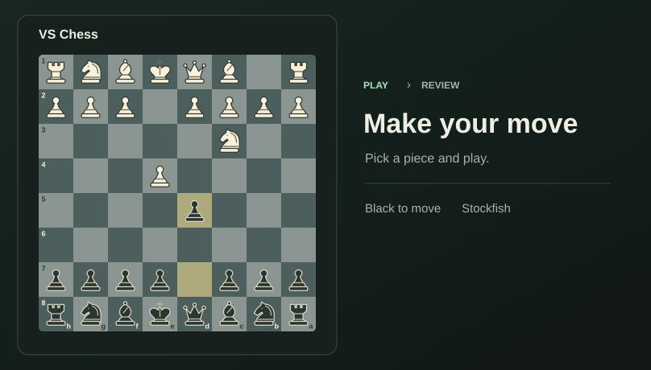

# VS Chess

A chessboard in your VS Code sidebar. Play Stockfish, solve a puzzle, or look back at a finished game. Everything runs offline.



## Install

Install [VS Chess from the Marketplace](https://marketplace.visualstudio.com/items?itemName=llriglana.vs-chess) in desktop VS Code 1.101 or later. Click the knight in the Activity Bar to open the board.

## Play, practice, and review

- **Play.** Pick one of 16 Stockfish levels and play White, Black, or a random side. For a game on the same computer, choose **Two players**. Use a clock if you like.
- **Practice.** The 9,781 Lichess puzzles can be filtered by rating and theme. **Hint** points to the piece to move, and **Show solution** plays the line. Your game pauses while you solve puzzles.
- **Review.** After the game, choose **Analyze game**. Stockfish draws an arrow for its best move in the current position. Go back one move to compare what you played with the alternatives. Select a line to play through it on the board. Scores are shown from White's side.

Move by clicking, dragging, or using the arrow keys and Enter when the board is focused. For more space, drag the view title to another sidebar. Change the interface language under **Settings → Language**.

## Build from source

Requires Node.js 22.22 or later.

```sh
npm ci
npm test
npm run vsix
```

Find the package in `outputs/`. To work on the extension, open the repository in VS Code, run `npm run build`, then press **F5**.

## License and credits

VS Chess is licensed under GPL-3.0-only. The engine is [Stockfish.js](https://github.com/nmrugg/stockfish.js), the rules use [chess.js](https://github.com/jhlywa/chess.js), and the puzzles come from [Lichess](https://database.lichess.org/#puzzles). See the [third-party notices](THIRD_PARTY_NOTICES.md) and [puzzle pack notes](data/README.md).

[Report a bug or suggest a change](https://github.com/Lllriglana/vs-chess/issues/new/choose).
