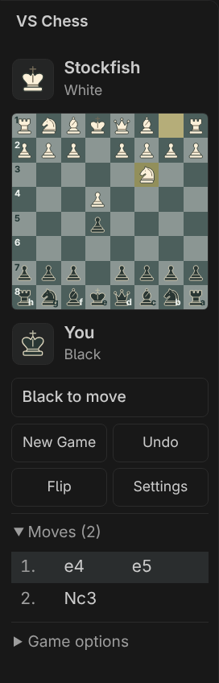

# VS Chess



Play a game or solve a puzzle without leaving your editor. VS Chess runs offline in a movable VS Code sidebar.

- **Play Stockfish** as White, Black, or a random color. Pick from 16 difficulty settings and set how long the engine thinks.
- **Play a friend** on the same computer, with optional clocks and auto-flip.
- **Train with 9,781 puzzles** from Lichess. Filter by rating or practice mates, forks, pins, sacrifices, and endgames.

## Install

Use desktop VS Code 1.101 or later. In the Command Palette, run **Extensions: Install from VSIX…** and select the `.vsix` file. Open **VS Chess** from the Activity Bar.

## At the board

Click or drag a piece to move it. With the board focused, use the arrow keys to navigate and **Enter** or **Space** to select. **Moves** opens the game history. Drag the view title to move the board to another sidebar or panel.

Choose **Puzzles** from the start screen or below a game in progress. **Hint** marks the piece to move. **Show solution** plays the rest of the line and leaves it below the board. **Back to games** resumes your game.

After a game, choose **Analyze game**. An arrow shows Stockfish's best move on the board. Hover over another suggestion or select it to see its arrow. Selecting a suggestion opens its continuation so you can play through it one move at a time. Use the buttons beneath the board or open **Moves** to revisit a position. Scores are from White's perspective, and the move played in the game is marked.

Change the interface language in **Settings → Language**.

Games are saved per workspace. Settings and solved puzzles are saved in your VS Code profile. Clocks pause when the view is hidden or while you solve a puzzle.

## Build from source

Use Node.js 22.22 or later.

```sh
npm ci
npm test
npm run vsix
```

The package is written to `outputs/`. To work on the extension in VS Code, open the project and press **F5**.

## Credits

VS Chess is licensed under GPL-3.0-only. It uses [Stockfish.js](https://github.com/nmrugg/stockfish.js), [chess.js](https://github.com/jhlywa/chess.js), and [Lichess puzzles](https://database.lichess.org/#puzzles). See the [third-party notices](THIRD_PARTY_NOTICES.md) for licenses and [puzzle pack notes](data/README.md) for the data sources.
